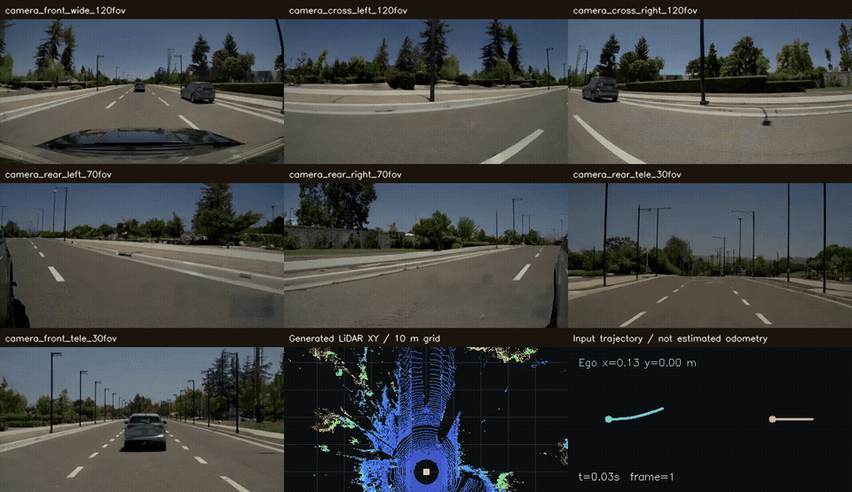
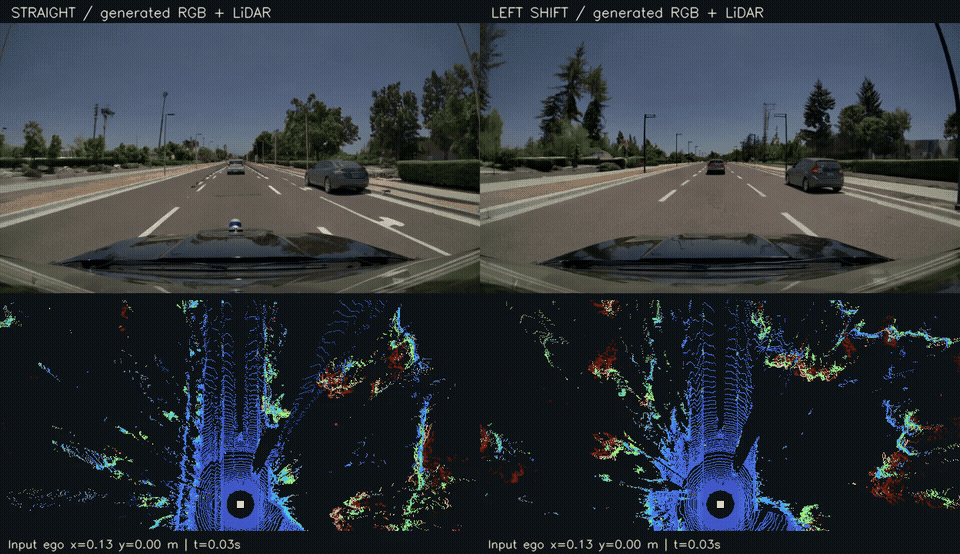
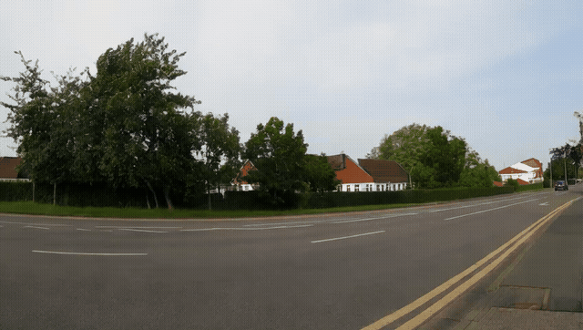
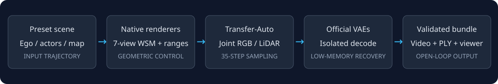
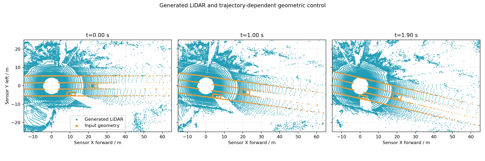

<div align="center">

# Cosmos3 Driving Simulation

**Cosmos3 自动驾驶世界模型复现：轨迹条件输入 → 七路视频 + LiDAR → 同步回放**

An independent, evidence-backed reproduction of NVIDIA Cosmos3 driving models.

[](https://github.com/PHCbhhgd/Cosmos3-Driving-Simulation/actions/workflows/ci.yml)


[复现指南](docs/REPRODUCTION.md) · [实测报告](docs/TEST_REPORT.md) · [输入输出](docs/INPUT_OUTPUT.md) · [已知问题](docs/KNOWN_ISSUES.md)

</div>

本项目参考 [Cosmos-Dreams-AlpaSim](https://github.com/GimpelZhang/Cosmos-Dreams-AlpaSim) 的展示与复现组织方式，整理 Cosmos3 系列的实际运行记录、可复用脚本和传感器回放。**主线已完成 Transfer-Auto 的直行／左横移两组开环生成**，包含七路 RGB、LiDAR range/intensity、标定点云导出及时间同步。

这里的轨迹是预设输入；当前未接入驾驶策略、车辆动力学、Radar、IMU 或 GNSS。生成数据有几何误差，不能直接当作高精度真值。Sim-Auto 在本次 RTX 4090 上未完成推理，原因和证据一并公开。

## 实际生成演示

### 七相机 + LiDAR：左横移



七路 **832×480、61 帧、30 FPS**；LiDAR **20 sweeps、10 Hz**。摄像头采样时刻为 0–2 秒，自车输入向前 8 米、向左 1 米。动图中的点云来自联合生成的 LiDAR；轨迹面板显示输入位姿。

### 直行与左横移对照



[下载 MP4 对照视频](media/trajectory-comparison.mp4) · [直行七相机动图](media/straight-sensors.gif)

两次使用相同 seed，但 caption 与未来控制不同，场景外观也有变化。它们是两个独立生成结果，尚未建立保持场景身份的严格反事实重放。

### 基础 Nano 单视频



单卡 BF16 + 官方 CPU/GPU 权重流式卸载，848×480、121 帧、24 FPS、35 步，安全检查开启。本次耗时 207.06 秒，PyTorch 峰值 allocated 4.84 GiB；该数字不等于整卡峰值占用。[原始结果记录](reports/nano/result.json)

## 模型与测试状态

| 模型 | 输入与输出 | 本次状态 |
| --- | --- | --- |
| [Cosmos3-Nano](https://huggingface.co/nvidia/Cosmos3-Nano) | 本测试：文本 → 单路视频 | 已生成并完整解码 |
| [Cosmos3-Nano-Transfer-Auto](https://huggingface.co/nvidia/Cosmos3-Nano-Transfer-Auto) | 逐视角 caption + 相机 WSM + LiDAR 几何控制 → 七路 RGB 与 LiDAR | 直行、左横移均已生成，独立官方 VAE 解码、打包和回放通过 |
| [Cosmos3-Nano-Sim-Auto](https://huggingface.co/nvidia/Cosmos3-Nano-Sim-Auto) | 因果滚动、蒸馏驾驶世界模型；固定四步路径 | 权重已准备；官方 `multiview_maskless_kv` 拒绝 sm89，未生成 |

所有状态均针对固定版本和本次测试。没有重新训练，也没有复现论文的全部指标。[版本固定清单](configs/versions.json) · [测试矩阵](configs/test-matrix.json)

## 处理流程



1. 创建合成自车／参与者轨迹、道路几何和参考相机标定。
2. 通过上游 WSM4 与 LiDAR range renderer 准备控制输入。
3. Transfer-Auto 联合采样七相机与 LiDAR latent；显存不足时保存采样结果，在独立进程中用原版 VAE 解码。
4. 验证视频、range/intensity、frame IDs 和坐标变换，导出 PLY，按时间戳回放。

## 快速开始

推荐 **Ubuntu 24.04、CUDA 13 兼容驱动、四张获分配的空闲 GPU**。实际 Auto 测试使用 4×RTX 4090 24 GiB；61 帧需要分离解码，121 帧采样 OOM。不要把四卡数量视为任意配置都能运行的保证。系统依赖、权限和环境差异见[完整复现指南](docs/REPRODUCTION.md)。

```bash
git clone https://github.com/PHCbhhgd/Cosmos3-Driving-Simulation.git
cd Cosmos3-Driving-Simulation
# 在本仓库根目录；先由管理员提供所需系统依赖
bash scripts/bootstrap.sh
bash scripts/run_env.sh bash scripts/install_auto.sh
bash scripts/run_env.sh bash scripts/install_wsm.sh

# 先在 Hugging Face 获得模型与 Guardrail1 授权，再用自己的凭据登录
bash scripts/run_env.sh storage/venvs/framework-hf-cli/bin/hf auth login
bash scripts/run_env.sh storage/venvs/auto/bin/python scripts/download_models.py transfer
bash scripts/run_env.sh storage/venvs/auto/bin/python scripts/download_framework_guardrails.py

# 浏览器测试使用独立 review 环境
storage/venvs/review/bin/python -m playwright install chromium

# 显式选择自己获分配的 GPU；这里仅演示编号，请按服务器占用修改
export COSMOS3_GPUS=0,1,2,3
bash scripts/run_env.sh bash scripts/prepare_scene.sh straight
bash scripts/run_env.sh bash scripts/prepare_scene.sh lane_change
bash scripts/run_scene_pipeline.sh straight
bash scripts/run_scene_pipeline.sh lane_change
```

脚本会检查指定 GPU 的现有计算任务，有占用就退出；不终止其他用户进程。每次推理写入新目录。公开环境安装命令已整理与静态检查，但尚未在一台全新机器上重新执行完整 GPU 流程；已生成结果来自原工作环境，详见[测试报告](docs/TEST_REPORT.md)。

回放自己生成的 bundle：

```bash
python3 scripts/serve_replay.py outputs/bundles/<实际运行目录> --port 8080
# 若在远程服务器运行，从个人电脑创建 SSH 端口转发：
# ssh -L 8080:127.0.0.1:8080 <user>@<server>
```

然后打开 `http://127.0.0.1:8080`，支持七路视频同步、时间轴跳转、RGB/WSM 切换和点云旋转。完整传感器数据已放在 [v0.1.0 Release](https://github.com/PHCbhhgd/Cosmos3-Driving-Simulation/releases/tag/v0.1.0)（约 287 MiB，附 SHA256）。包含两组七相机视频、LiDAR、PLY、标定和回放器。[发布指南](docs/PUBLISHING.md)说明如何重新构建附件。

## 测了什么

| 检查 | 直行 | 左横移 |
| --- | --- | --- |
| 七路视频完整解码、61 帧 / 30 FPS | 通过 | 通过 |
| 20 次 LiDAR 扫描、frame IDs / range / intensity | 通过 | 通过 |
| Pandar128 标定投影、XYZ 距离往返与 PLY | 通过 | 通过 |
| 实际浏览器解码、跳转、模式切换、同步播放 | 通过 | 通过 |
| 稀疏受控射线平均有效覆盖 | 90.42% | 91.13% |
| 逐扫描 range MAE 的平均值 | 6.73 m | 4.35 m |

最后两项仅衡量稀疏输入几何控制上的一致性，没有物理精度通过阈值，也不是与实车 LiDAR 真值比较。完整证据在 [reports/](reports/README.md)。



## 仓库结构

```text
configs/   固定源码/模型版本、Nano 依赖约束与测试矩阵
scripts/   环境、场景准备、推理、解码恢复、验证、回放和发布工具
patches/   固定上游版本的两文件补丁及上游许可证
docs/      复现指南、测试报告、输入输出和排错说明
reports/   脱敏的历史运行证据和输入轨迹
media/     实际输出的动图、视频、抽帧与流程图
tests/     CPU 测试；不冒充模型推理或物理精度验证
```

本地 `repos/`、`storage/`、`outputs/`、`artifacts/`、`release/` 均被忽略。CPU 检查：`python3 -m unittest discover -s tests -v`；发布检查：`python3 scripts/audit_public_repo.py`。

## 致谢与许可

感谢 [NVIDIA Cosmos Framework](https://github.com/NVIDIA/cosmos-framework)、Cosmos3 模型及 WSM 工具、[Cosmos-Dreams-AlpaSim](https://github.com/GimpelZhang/Cosmos-Dreams-AlpaSim) 的参考工作。本项目为独立复现，与 NVIDIA 无官方关联。

原创脚本和文档使用 [Apache-2.0](LICENSE)。Framework 补丁保留 [OpenMDW-1.1](patches/LICENSE.OpenMDW) 条款；模型权重、参考标定及上游材料遵循各自许可，权重不随仓库分发。详见 [NOTICE](NOTICE)。
