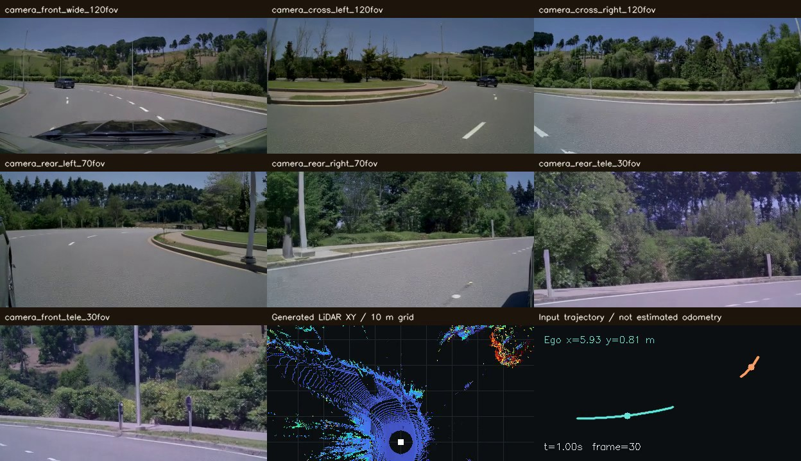
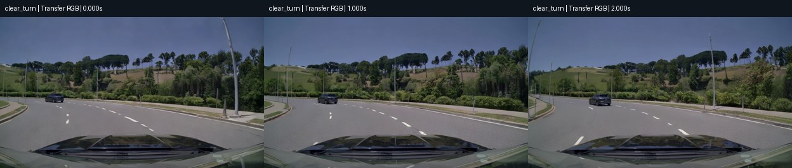
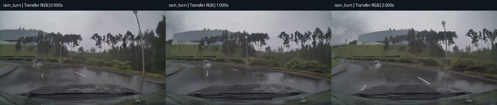
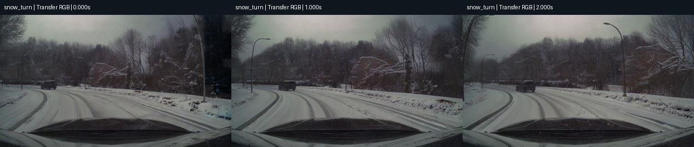
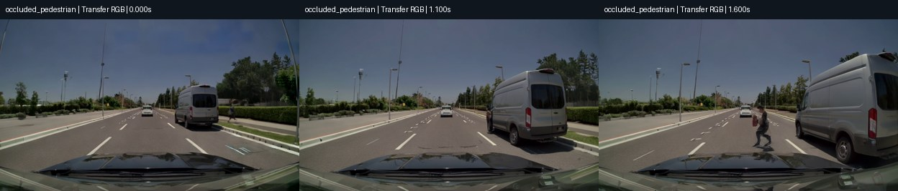
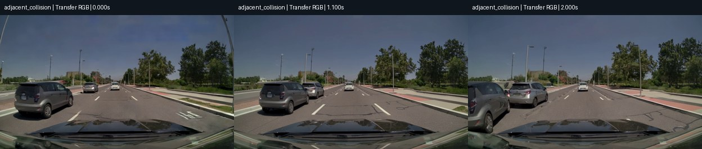
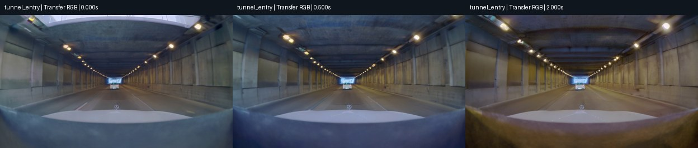
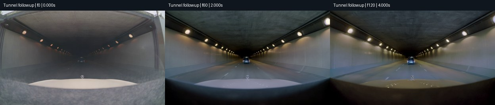
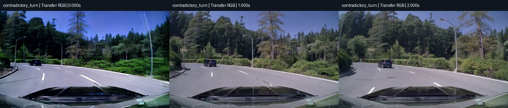
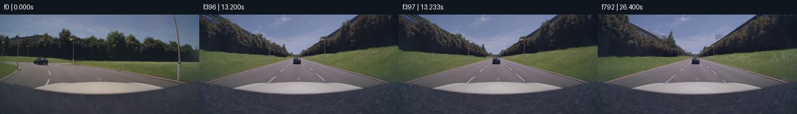

<div align="center">

# Cosmos3 Driving Simulation

**自动驾驶世界模型复现与压力测试：轨迹控制 → 七路视频 + LiDAR → 同步回放**

[](https://github.com/PHCbhhgd/Cosmos3-Driving-Simulation/actions/workflows/ci.yml)


[复现指南](docs/REPRODUCTION.md) · [业务与边界报告](docs/ROBUSTNESS_TESTS.md) · [输入输出说明](docs/INPUT_OUTPUT.md) · [运行证据](reports/README.md) · [问题排查](docs/KNOWN_ISSUES.md)

</div>

本项目参考 [Cosmos-Dreams-AlpaSim](https://github.com/GimpelZhang/Cosmos-Dreams-AlpaSim)，实际运行 Cosmos3 模型并公开成功结果、失败样本和复现脚本。重点测试雨雪转弯、鬼探头、邻车接触、隧道，以及长视频中的场景连续性。

**GitHub 保存代码、报告、场景图片和小视频；完整传感器数据包、大型原始视频与模型权重留在本地。** 首页每个场景使用一张实测抽帧图，小视频通过链接查看。

## 1. 三个模型，目前测到了什么

| 模型 | 本次输入 → 输出 | 实际状态 |
| --- | --- | --- |
| [Cosmos3-Nano](https://huggingface.co/nvidia/Cosmos3-Nano) | 文本 → 单路视频 | 新增 12 次请求：11 段生成并完整解码，1 次 Guardrail 拒绝；最长样本最后时刻 16.5 秒 |
| [Transfer-Auto](https://huggingface.co/nvidia/Cosmos3-Nano-Transfer-Auto) | 逐视角文字 + WSM + LiDAR 几何控制 → 七路 RGB + LiDAR | 完成直行、左横移及下方七个联合场景；另有单相机时长测试 |
| [Sim-Auto](https://huggingface.co/nvidia/Cosmos3-Nano-Sim-Auto) | 因果滚动、蒸馏驾驶世界模型，固定四步路径 | 当前 RTX 4090 / sm89 被官方 `multiview_maskless_kv` 拒绝，未生成 |

联合场景每例为 **七路 832×480 视频、61 帧 / 30 FPS，20 次 LiDAR 扫描 / 10 Hz**，相机最后采样时刻为 2 秒。完整 latent 采样后采用独立官方 VAE 解码，未重新采样；打包、点云导出和真实浏览器回放检查通过。



上图取自晴天左转的实际同步回放。当前属于预设地图与轨迹驱动的**开环生成**；输入位姿不是物理真值，尚未接入驾驶策略、车辆碰撞动力学、Radar、IMU 或 GNSS。

## 2. 业务场景实测

以下图片均来自实际生成视频，顶部标明模型和时间。七组 Transfer 联合样本使用相同推理配置；晴、雨、雪及转向冲突组共享相同几何控制和 seed。详细指标、输入 WSM、LiDAR 对照和事件密集抽帧见[完整报告](docs/ROBUSTNESS_TESTS.md)。

### 晴天左转：天气对照基线



前车与道路有连续左弯运动，路面存在轻微纹理斑。短片覆盖约 **31.3°** 转弯。稀疏受控射线有效覆盖 **92.82%**，逐扫描 range MAE 均值 **3.87 m**。

[Transfer 前视视频](media/robustness/transfer-clear_turn-front.mp4) · [七相机 + LiDAR](media/robustness/transfer-clear_turn-sensors.mp4) · [Nano 视频](media/robustness/nano-business-clear_turn.mp4)

### 大雨左转：关键车辆明显退化



湿路和雨水可见，但 Transfer 前车**从首帧起呈白色重影、难以辨认**；覆盖降至 **64.08%**，range MAE 均值升至 **6.90 m**。Nano 也出现较大的黑色/粉色前景伪影。这是本轮明确的坏样本，不是雨天失败率统计。

[Transfer 前视视频](media/robustness/transfer-rain_turn-front.mp4) · [七相机 + LiDAR](media/robustness/transfer-rain_turn-sensors.mp4) · [Nano 视频](media/robustness/nano-business-rain_turn.mp4) · [晴雨放大对照](media/robustness/transfer-clear-rain-car-detail.jpg)

### 降雪左转：外观连续，未验证雪地物理



积雪、车辙和前车可辨，左弯运动连续；部分边缘和长焦视角有条纹/纹理伪影。覆盖 **90.86%**，range MAE 均值 **4.09 m**。天气文字没有提供经过标定的 LiDAR 降水散射或轮胎附着模型。

[Transfer 前视视频](media/robustness/transfer-snow_turn-front.mp4) · [七相机 + LiDAR](media/robustness/transfer-snow_turn-sensors.mp4) · [Nano 视频](media/robustness/nano-business-snow_turn.mp4)

### 鬼探头：显露偏差与身份保持问题



Transfer 生成了显露和横穿，但时间/位置未严格跟随输入，还额外生成路边行人。Nano 的另一个样本在 **3.375 秒**首次明确出现双人形重影，随后融合；不能直接沿用输入 box 作为生成画面的精确标注。

[Transfer 前视视频](media/robustness/transfer-occluded_pedestrian-front.mp4) · [七相机 + LiDAR](media/robustness/transfer-occluded_pedestrian-sensors.mp4) · [Nano 视频](media/robustness/nano-business-occluded_pedestrian.mp4) · [Nano 身份分裂细节](media/robustness/nano-pedestrian-detail.jpg) · [RGB/WSM 对照](media/robustness/transfer-pedestrian-front-detail.jpg)

### 邻车接触：接近可见，事故动力学未成立



Transfer 两车持续接近，约 **1.1 秒**出现接触外观，身份基本保留；未确证冲击和受撞车响应。Nano 原事故描述被 Guardrail 拒绝，改为低速接触描述后生成，但车辆运动很弱。**不能标为真实车祸仿真成功。**

[Transfer 前视视频](media/robustness/transfer-adjacent_collision-front.mp4) · [七相机 + LiDAR](media/robustness/transfer-adjacent_collision-sensors.mp4) · [Nano 低速接触](media/robustness/nano-contact-adjacent_contact.mp4) · [拒绝记录](reports/robustness/nano/nano-business-20261103/adjacent_collision/result.json)

### 隧道：洞内连续，联合样本的室外段不足



Transfer 墙顶、灯列和前车大体连续，但相机起点距入口仅约 **2.25 m**，缺少完整室外过渡证据；Nano 可见约 2 秒入洞。入口移至 10 m 的 4 秒前广角补测仍过早呈现洞内外观，未充分遵循预计约 2.06 秒越过入口的过程。

[Transfer 前视视频](media/robustness/transfer-tunnel_entry-front.mp4) · [七相机 + LiDAR](media/robustness/transfer-tunnel_entry-sensors.mp4) · [Nano 入洞视频](media/robustness/nano-business-tunnel_entry.mp4) · [入口细查](media/robustness/transfer-tunnel-entry-detail.jpg)

**隧道补测：入口移远后**



相机初始距入口约 8.25 m，生成首帧却已几乎贴近洞口，缺少应有的室外接近段。[RGB / WSM 对照](media/robustness/transfer-tunnel-approach-controls.jpg) · [机器记录](reports/robustness/transfer-tunnel/)；原始视频仅本地保留。

### 转向冲突：左弯几何与右转文字



WSM/LiDAR 要求左转，文字要求右转；实际道路和前车仍跟随左弯几何。前后长焦开头有明显彩色网纹，单次采样不能证明伪影由文字冲突造成；矛盾条件无法同时满足，遵循几何本身不计失败。

[Transfer 前视视频](media/robustness/transfer-contradictory_turn-front.mp4) · [七相机 + LiDAR](media/robustness/transfer-contradictory_turn-sensors.mp4) · [七视角抽帧](media/robustness/transfer-contradictory_turn-cameras.jpg)

## 3. 多长时间后会不稳定

**本轮没有得到统一的“第 N 秒必然崩坏”阈值。** 初始生成失败、遮挡后身份错误和续接变化须分别判断，静止或事件未发生也不能证明世界稳定。

| 路径 | 已完成测试 | 观察与证据 |
| --- | --- | --- |
| Nano 文本生成 | 最后时刻 5 / 10 / 16.5 秒 | [5 秒](media/robustness/nano-duration-frames-121.mp4)、[10 秒](media/robustness/nano-duration-frames-241.mp4)、[16.5 秒](media/robustness/nano-duration-frames-397.mp4)；部分样本车辆运动很弱 |
| Nano 持续行驶 | 397 帧 / 24 FPS，最后时刻 16.5 秒 | [实际运动视频](media/robustness/nano-motion-duration-moving_camera_frames_397.mp4)；每秒抽帧未见整体崩坏，前车初始出现位置不符合要求 |
| Transfer 前广角 RGB | 121 / 241 / 397 帧，最后时刻 4 / 8 / 13.2 秒 | 有持续前进运动，每秒抽帧未见整体崩坏；大车头/暗角从首帧即存在。[13.2 秒控制对照](media/robustness/transfer-duration-front-rgb-397-controls.jpg) |
| Transfer 分段续生成 | 已完整解码 793 帧 / 30 FPS，最后时刻 26.4 秒 | 每秒抽帧和 13.2 秒续接逐帧未见明确整体崩坏；仅晴天单视角。[时序图](media/robustness/transfer-duration-front-rgb-793.jpg) / [控制对照](media/robustness/transfer-duration-front-rgb-793-controls.jpg) |
| 联合七相机 + LiDAR | 61 帧，最后时刻 2 秒 | 121 帧请求采样 OOM，属于当前配置容量限制，不代表 2 秒后世界失稳 |



单视角 RGB 长测不代表七相机与 LiDAR 的同等时长能力。LiDAR 发布表示只保留 **5–100 m**，5 m 内险情不能由本配置直接保真。所有质量结论均只覆盖本次场景和 seed，没有实车物理真值。

## 4. 复现与本地回放

本轮 Auto 使用 **4×RTX 4090 24 GiB**；联合样本需要分离 VAE 解码，每例推理至检查约 23–28 分钟。完整安装、模型授权和下载步骤见[复现指南](docs/REPRODUCTION.md)，业务与时长复跑见[测试报告](docs/ROBUSTNESS_TESTS.md)。

```bash
git clone https://github.com/PHCbhhgd/Cosmos3-Driving-Simulation.git
cd Cosmos3-Driving-Simulation
# 先按 docs/REPRODUCTION.md 完成环境、模型与 Guardrail 授权准备
export COSMOS3_GPUS=0,1,2,3  # 替换为自己获分配的空闲卡
bash scripts/run_env.sh bash scripts/prepare_scene.sh straight
bash scripts/run_scene_pipeline.sh straight
```

脚本检查 GPU 占用并保留既有结果。未在全新机器上重跑完整安装流程；固定版本和本次原环境证据见 [configs/versions.json](configs/versions.json) 与 [reports/](reports/README.md)。

本地业务场景回放示例：

```bash
python3 scripts/serve_replay.py outputs/robustness/transfer-business-20261103/clear_turn/bundle --port 8080
# 浏览器打开 http://127.0.0.1:8080；远程服务器可使用 SSH 端口转发
```

| 内容 | 保存位置 |
| --- | --- |
| 图片、小视频、脚本、配置、脱敏报告 | GitHub：`media/`、`scripts/`、`configs/`、`reports/` |
| 原始七相机、LiDAR、PLY、标定、回放 bundle | 仅本地：`outputs/robustness/transfer-business-20261103/` |
| 原始长视频与分段续生成记录 | 仅本地：`outputs/robustness/transfer-duration-20261103/` |
| 完整校验归档 | 仅本地：`release/`，已被 Git 忽略 |
| 模型、第三方源码与运行环境 | 仅本地：`storage/`、`repos/`，已被 Git 忽略 |

[直行/左横移小视频](media/trajectory-comparison.mp4) · [Nano 基础演示](media/nano.gif) · [全部小型媒体](media/robustness/) · [本地归档与发布规则](docs/PUBLISHING.md)

CPU 工具检查：`python3 -m unittest discover -s tests -v`；公开文件检查：`python3 scripts/audit_public_repo.py`。GitHub Actions 验证工具链，不能替代 GPU 模型和物理评测。

## 致谢与许可

感谢 [NVIDIA Cosmos Framework](https://github.com/NVIDIA/cosmos-framework)、Cosmos3 与 WSM 工具，以及 [Cosmos-Dreams-AlpaSim](https://github.com/GimpelZhang/Cosmos-Dreams-AlpaSim) 的参考工作。本项目为独立复现，与 NVIDIA 无官方关联。

原创代码与文档采用 [Apache-2.0](LICENSE)；上游补丁保留 [OpenMDW-1.1](patches/LICENSE.OpenMDW)，权重和参考材料遵循各自许可，详见 [NOTICE](NOTICE)。模型权重不随仓库分发。
