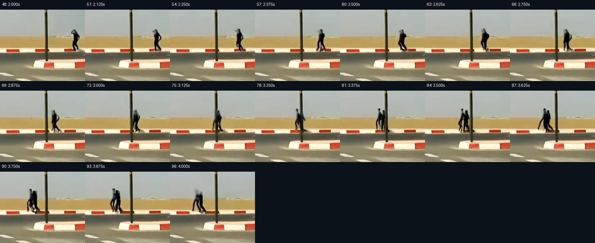
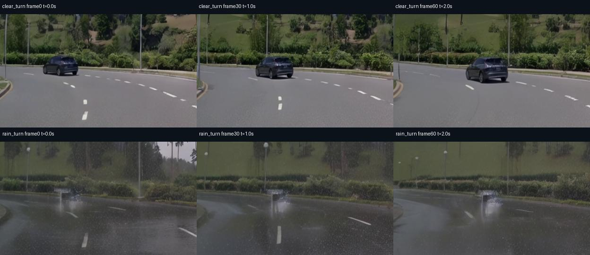
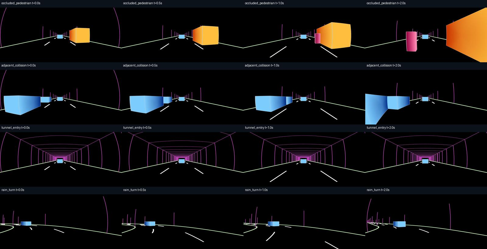

# 业务场景与边界测试

本轮测试区分三个问题：能否生成并完整解码；是否遵循轨迹、天气与事件要求；同一段连续视频中，何时首次出现可观察的退化。文件检查通过不代表后两项通过。

## Nano 实测结果

12 次请求中，11 段视频实际生成并完整解码，1 次事故描述被官方 Guardrail 拒绝。[逐次机器记录](../reports/robustness/nano/) 保存原提示词、seed、耗时、显存峰值、SHA256 与解码诊断。以下为人工抽帧审阅，不能替代带真值的自动评测。

| 请求 | 实际观察 | 视频 |
| --- | --- | --- |
| 固定相机 5 / 10 / 16.5 秒 | 背景稳定，但蓝车运动很弱；10 秒样本开头即出现不符合路边相机设定的车头和广角暗角，属于初始条件遵循失败 | [5秒](../media/robustness/nano-duration-frames-121.mp4) / [10秒](../media/robustness/nano-duration-frames-241.mp4) / [16.5秒](../media/robustness/nano-duration-frames-397.mp4) |
| 持续行驶 16.5 秒，seed1 | 有持续前进视差，蓝车约 3 秒从左侧进入后前驶；按 1 秒抽帧未见整体画面崩溃，没有 3D 真值可证明全局一致 | [原视频](../media/robustness/nano-motion-duration-moving_camera_frames_397.mp4) |
| 晴天左转 | 连续前进和左弯透视可见，前车大致保持身份 | [原视频](../media/robustness/nano-business-clear_turn.mp4) |
| 大雨左转 | 湿路、水迹与雨刷可见；上缘有反复出现的黑色/粉色大块前景，需警惕不合理雨刷或前景结构 | [原视频](../media/robustness/nano-business-rain_turn.mp4) |
| 降雪左转 | 可见降雪、积雪路沿、车辙和连续左弯；不代表雪地车辆动力学有效 | [原视频](../media/robustness/nano-business-snow_turn.mp4) |
| 鬼探头 | 行人出现后经过路灯杆遮挡，frame81 / **3.375 秒**可辨两个人形，随后重影、融合；未保持单人身份，横穿自车车道的事件也不充分 | [原视频](../media/robustness/nano-business-occluded_pedestrian.mp4) |
| 邻车事故原描述 | Guardrail 在采样前拒绝，0.71 秒退出；没有生成视频，不能计为质量失败 | [拒绝记录](../reports/robustness/nano/nano-business-20261103/adjacent_collision/result.json) |
| 低速保险杠接触描述 | 保持安全检查，成功生成两辆邻车；相对位置变化很小，未清楚表现接近→接触→停止，不能计为事故复现成功 | [原视频](../media/robustness/nano-contact-adjacent_contact.mp4) |
| 隧道入口 | 约 2 秒入洞，室外到暗部/暖灯的变化可见，0–5 秒抽帧中墙顶和道路大体连续 | [原视频](../media/robustness/nano-business-tunnel_entry.mp4) |

**本轮没有测出统一的“第 N 秒世界必然不稳定”。** 已确认的更具体边界是：遮挡后行人身份失败可在约 3.4 秒发生；16.5 秒行驶样本仍可保持视觉连续；若动态事件根本没有生成，就不能用静止画面证明世界稳定。上述结论均只覆盖本次 seed 和提示词。



图中是实际视频的局部放大：原请求要求同一行人，3.375–3.875 秒出现可辨的人形重影。抽帧间隔为 3 帧 / 0.125 秒；3.375 秒是该审阅中首次明确辨认的时间，不是模型的通用极限。

## Transfer 联合传感器实测

以下仅列已完成的场景；其余场景和 RGB 时长测试的准备不算生成成功。三例均完成 35 步联合采样，在同驻 LiDAR VAE 解码时 OOM；保存的完整 latent 已使用独立官方 VAE 解码，未重新采样。七路视频、20 次 LiDAR 扫描、点云打包和真实浏览器回放检查通过。

| 场景 | 可见结果 | 稀疏射线有效覆盖 | 平均逐扫描 range MAE | 预览 |
| --- | --- | --- | --- | --- |
| 晴天左转 | 车道和前车有连续左弯运动，前车大致跟随控制框；路面有轻微纹理斑 | 92.82% | 3.87 m | [七相机 + LiDAR](../media/robustness/transfer-clear_turn-sensors.mp4) / [前广角](../media/robustness/transfer-clear_turn-front.mp4) |
| 大雨左转 | 湿路、雨水与灰暗天气可见，但前车难以辨认，车体近似白色重影，从开头即存在 | 64.08% | 6.90 m | [七相机 + LiDAR](../media/robustness/transfer-rain_turn-sensors.mp4) / [前广角](../media/robustness/transfer-rain_turn-front.mp4) |
| 降雪左转 | 前车、积雪路沿和车辙可辨，左弯运动连续；部分边缘有彩色条纹与纹理伪影 | 90.86% | 4.09 m | [七相机 + LiDAR](../media/robustness/transfer-snow_turn-sensors.mp4) / [前广角](../media/robustness/transfer-snow_turn-front.mp4) |



上图每列为 0、1、2 秒，上排晴天、下排大雨，均从实际前广角视频裁切。几何控制与 seed 相同，生成的背景、材质和车辆外观仍会因文字变化而改变；没有建立保持场景身份的反事实仿真。这张图支持“本次雨天样本的受控前车表现退化”，不能据单次采样估计雨天失败率。

原始机器证据见 [晴天](../reports/robustness/transfer-business/clear_turn/)、[雨天](../reports/robustness/transfer-business/rain_turn/) 和 [雪天](../reports/robustness/transfer-business/snow_turn/)。box 附近点数只是辅助诊断：晴天所抽取扫描约 900–1150 点，大雨约 29–145 点，雪天约 830–955 点；附近点不等于语义正确的前车点。上述射线指标没有物理合格阈值，也没有提供真实雨滴散射参考。

## 测试设计

模型、Framework、VAE 与低显存补丁沿用 [固定版本](../configs/versions.json)。模型权重不修改，不关闭默认安全配置。Nano 使用官方流式卸载、848×480、24 FPS、35 步、guidance 6，safety checker 开启；Transfer 使用四卡 CP4 / DP-shard4、480p、35 步、guidance 3、shift 10、官方逐视角 negative prompt。该配置下实际相机输出为 832×480。官方 negative prompt 也包含抑制“雨雾严重遮挡附近车辆和车道”的描述；解释大雨结果时必须保留这一条件，不能把输出差异全部归因于模型本身。

### 七相机 + LiDAR 业务场景

[场景定义](../configs/robustness-cases.json) 与 [场景构造器](../scripts/prepare_business_scene.py) 给出可检查的几何和参与者轨迹。每例 61 帧 / 30 FPS，最后相机采样时刻 2 秒；联合输出预期为 20 次 / 10 Hz 的 LiDAR 扫描。这些是业务情形的**合成测试**，没有使用对应的实车录像作为真值。

| 场景 | 固定的输入 | 重点检查 |
| --- | --- | --- |
| 晴天左转 | 6 m/s、半径 22 m 的左弯，前车、车道与路沿 | 晴天基线、转向透视、前车身份 |
| 大雨左转 | 与晴天相同的几何和 seed，只改变天气 caption | 可见雨丝、湿路与喷雾；天气能否贯穿各视角 |
| 降雪左转 | 同上，只改变为降雪和积雪 caption | 是否生成降雪；车道、前车是否被雪覆盖或消失 |
| 鬼探头 | 路右货车遮挡行人，行人从右向左冲刺横穿 | 遮挡前不能提前出现、出现后不能消失；外观与 LiDAR 支持 |
| 邻车事故 | 左侧车辆以 5 m/s 接近停止车辆，1.1 秒发生预设 box 接触，随后轻微偏航 | 是否真正表现接触和减速，车辆是否融合、换身份或穿插 |
| 隧道入口 | 从后轴 x=0 行驶到 x=8 m，入口 x=4 m | 是否从室外进入有顶空间；墙顶、照明与曝光是否持续 |
| 控制冲突 | 几何保持左弯，文字明确要求右转 | 遵循哪种控制，有无画面撕裂或控制失效 |

左弯的短联合样本覆盖约 **31.3°**，不是完整 90° 转弯。行人从 t=0.4–1.6 秒横移 6 m，平滑轨迹峰值 7.5 m/s，属于快速冲刺压力测试。相机 WSM 已检查开头遮挡、约 1 秒时行人显露。车辆接触由轨迹直接指定，没有碰撞动力学、车身形变或碎片。隧道仅提供入口、屋顶边缘与每隔 4 m 的线框结构，**没有密集墙面和屋顶网格**。



这张图是**合成输入 WSM 控制**。从上到下为鬼探头、邻车接触、隧道线框、左弯；每行是 0、0.5、1、2 秒。晴天、雨、雪、文字冲突四例的七路 WSM 视频与 LiDAR 控制数组一致，见 [实际比较记录](../reports/robustness/matched-controls.json)。

雨、雪不会改变输入的道路几何或引入经过验证的 LiDAR 雨雪散射。几何控制第二通道为占用占位值，不是实测反射率。生成的 LiDAR 强度及天气变化不能据此解释成真实传感器物理。

### 时长与运动测试

| 模型 / 路径 | 请求 | 可以回答的问题 |
| --- | --- | --- |
| Nano / 固定路边相机文字 | 独立 121、241、397 帧，即最后采样时刻 5、10、16.5 秒 | 不同时长的提示词遵循、背景及车辆保持情况 |
| Nano / 行驶相机文字 | 397 帧、seed1，要求持续行驶和明显视差 | 有实际运动时后段的几何与身份变化 |
| Transfer / 前广角 RGB | 独立 121、241、397 帧，最后采样时刻 4、8、13.2 秒 | 受几何控制的单视角长序列质量 |
| Transfer / 前广角 RGB 续生成 | 两个 397 帧 chunk，反馈一帧，总计 793 帧 / 30 FPS | 同一序列跨 chunk 后的连续性，最后采样时刻 26.4 秒 |
| Transfer / 联合七相机 + LiDAR | 61 帧 | 本轮业务情形下的短序列与跨传感器诊断 |
| Sim-Auto | 官方硬件检查 | 当前硬件能否运行，不能回答视频质量或滚动稳定时长 |

长 RGB 控制来自真实连续渲染的 797 帧，未降低 FPS 或重复视频。第二个 chunk 的控制从 frame 396 开始，与第一段最后一帧一致；拼接时去掉一帧反馈。原生 joint 路径只支持一个 caption chunk，因此 RGB 续生成结果**不代表七相机 + LiDAR 的同等时长能力**。

长测专用场景让自车和前车均以 6 m/s 行驶，沿道路弧长保持 24 m 间距，完成 90° 左弯后沿切线前进。短联合场景原本的前车速度为 3 m/s，若直接延长，自车约 8 秒就会追上前车；该准备版本保留但不用于长测，避免把输入轨迹重叠误判为模型失稳。

不同时长请求使用相同 seed，也不保证共享相同前缀。它们是独立采样，不能通过对比“5 秒视频”和“10 秒视频”认定某个具体秒数开始失稳。

## 如何判断退化

人工审阅分别记录：时间戳、具体可见问题、输入中是否提供了对应结构、检查的是哪些相机与帧。关注车辆/行人消失或身份变化、静态结构变形、跨 chunk 跳变、天气不遵循、几何与文字冲突。问题若从第一帧就存在，记为初始生成或条件遵循失败。

“首次观察到退化”的时间只适用于具体场景、seed、分辨率和推理配置。未观察到问题时，结论只是“在已检查的窗口未发现该问题”；无运动、弱事件或不完整控制不能用来证明长时世界稳定。单 seed 不是失败率评估。

[视频审阅工具](../scripts/review_video.py) 完整解码所有帧、计算 SHA256，并导出带时间戳的抽帧。亮度、锐度和帧间像素差仅是描述性数值，不能自动判定物理稳定性。

[LiDAR 几何诊断](../scripts/evaluate_joint_controls.py) 比较稀疏受控射线上的有效覆盖与 range 误差，没有物理精度通过阈值。[参与者支持诊断](../scripts/evaluate_actor_support.py) 统计预设 box 表面附近的生成点，使用扫描开始位姿，未 deskew；附近道路或其他物体可能造成假支持，不能当作目标检测或 RGB/LiDAR 语义一致性的证明。

已执行的 [LiDAR 边界探针](../reports/robustness/lidar-boundaries.json) 直接调用未修改的官方编码与保存函数，未运行生成模型：2 m、4.99 m 和 100.01 m 的有效输入被置为无效；5 m 与 100 m 保留。默认 validity 阈值 0.5，0.49 被丢弃，0.5 保留。因此，发布配置下 **5 米内近场险情无法通过该 LiDAR 表示直接保真**；不能只看 RGB 是否生成了行人。探针脚本为 [probe_lidar_boundaries.py](../scripts/probe_lidar_boundaries.py)。

CUDA OOM 单独记为该配置的容量限制。Sim 的 sm89 拒绝单独记为硬件兼容限制。这两类都不能说明“世界在某秒崩坏”。

## 复跑方式

先按 [复现指南](REPRODUCTION.md) 准备固定版本、兼容运行环境与模型，并分配四张空闲 GPU。下列 Python/命令需要在对应 WSM 或 Auto 环境中运行；共享服务器不要直接占用已有计算任务的卡。

```bash
python scripts/prepare_business_scene.py rain_turn --frames 61
python scripts/render_scene_wsm.py storage/scenarios/rain_turn --frames 61
cosmos-auto-lidar-rangemap \
  --input-root storage/scenarios/rain_turn \
  --output-root storage/scenarios/rain_turn/lidar_controls \
  --clip-id rain_turn --max-frames 21 --export-control --device cpu --no-vis
python scripts/export_scene_request.py storage/scenarios/rain_turn --frames 61
```

对其余场景重复准备步骤。[批量执行器](../scripts/benchmark_transfer.py) 接受 `--runtime`（在命令前执行的环境包装脚本）、`--python`（Auto 虚拟环境解释器）、`--gpus`、`--cases`、`--output`，自动预检 GPU，保存每例结果，并在完整 joint latent 已保存而同驻解码 OOM 时尝试独立官方 VAE 解码。输出目录必须是新目录。

```bash
python scripts/prepare_business_scene.py clear_turn --frames 797 --lead-speed 6 \
  --output storage/scenarios/temporal_following
python scripts/render_scene_wsm.py storage/scenarios/temporal_following --frames 797 --front-only
python scripts/prepare_temporal_requests.py storage/scenarios/temporal_following
```

[RGB 时长执行器](../scripts/benchmark_transfer_rgb.py) 使用 `--scene storage/scenarios/temporal_following` 和同样的 runtime / python / GPU 参数。Nano 的 [执行器](../scripts/benchmark_nano.py) 默认执行三档时长，也可通过 `--cases-config` 指定 [业务提示词](../configs/nano-business-cases.json) 或 [持续行驶长视频](../configs/nano-motion-duration.json)。Nano safety checker 保持开启；事故原提示词被 Guardrail 拒绝的结果须单独保留，不能计为画面质量失败。独立 VAE 恢复只做解码，不额外重跑 Guardrail。

本轮机器使用已有隔离环境。可移植源码经过 CPU 检查不等于已在一台全新机器上重新安装并跑完全部 GPU 测试。
